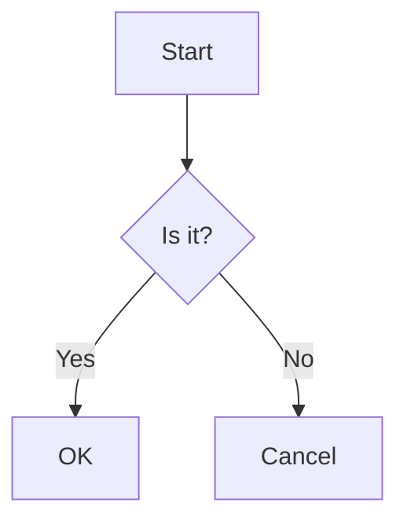

# MarkdownRenderer

MarkdownRenderer is a renderer for markdown, based on a fork of the [docsharp](https://github.com/manfromarce/DocSharp) and [Open-XML-SDK](https://github.com/dotnet/Open-XML-SDK) projects.

## Installation

Packages can be installed via NuGet:  
[](https://www.nuget.org/packages/MarkdownRenderer.Markdown/)

## Features

The library allows converting Markdown into Microsoft Word (`.docx`) and PowerPoint (`.pptx`) formats. It supports various markdown elements:
- Headings and Paragraphs
- Text formatting (Bold, Italic)
- Lists (Ordered and Unordered)
- Code Blocks and Inline Code
- Blockquotes
- Tables
- Mathematics (Inline and Block equations)
- Mermaid Diagrams
- Custom Containers
- Emojis and Smilies
- Footnotes

## Usage

Below is a complete example of generating a DOCX and a PPTX document from Markdown strings:

```csharp
using System;
using DocumentFormat.OpenXml.Presentation;
using MarkdownRenderer.Markdown;

namespace MarkdownRenderer.Sample
{
    class Program
    {
        static void Main(string[] args)
        {
            Console.WriteLine("Generating Sample Documents from Markdown...");

            string docxMarkdown = @"# Advanced Features for Word Document

## Tables

| Header 1 | Header 2 |
| -------- | -------- |
| Cell 1   | Cell 2   |

## Mathematics

An inline equation $E=mc^2$ and a block equation:

$$
a^2 + b^2 = c^2
$$

## Custom Containers

:::callout
This is a custom container (callout), which translates to a blockquote style in Word.
:::

## Emoji and Smilies

Hello world! :smile: :rocket:

## Footnotes

Here is a statement with a footnote.[^1]

[^1]: This is the text of the footnote.

## Mermaid Diagram


";

            string pptxMarkdown = @"# Lists

This is a paragraph on the first slide.
It has some **bold** and *italic* text.

* Item 1
* Item 2
  * Subitem A

# Code Areas

This is the second slide.

```csharp
// some code
int x = 42;
```

> A quote on the second slide.
";

            var converter = new MarkdownConverter();
            var sourceDocx = MarkdownSource.FromMarkdownString(docxMarkdown);
            var sourceSlides = MarkdownSource.FromMarkdownString(pptxMarkdown);

            // Generate DOCX
            string docxPath = "sample.docx";
            converter.ToDocx(sourceDocx, docxPath);
            Console.WriteLine($"Generated {docxPath}");

            // Generate PPTX
            string pptxPath = "sample.pptx";
            converter.ToSlides(sourceSlides, SlideSizeValues.Screen16x9, pptxPath);
            Console.WriteLine($"Generated {pptxPath}");

            Console.WriteLine("Done!");
        }
    }
}
```

## License

MarkdownRenderer is licensed under [MIT license](LICENSE) and can be used for both open source and commercial projects.
The original forked projects are licensed under [MIT](https://github.com/manfromarce/DocSharp/blob/main/LICENSE) (docsharp) and [MIT](https://github.com/dotnet/Open-XML-SDK/blob/main/LICENSE) (Open-XML-SDK).

